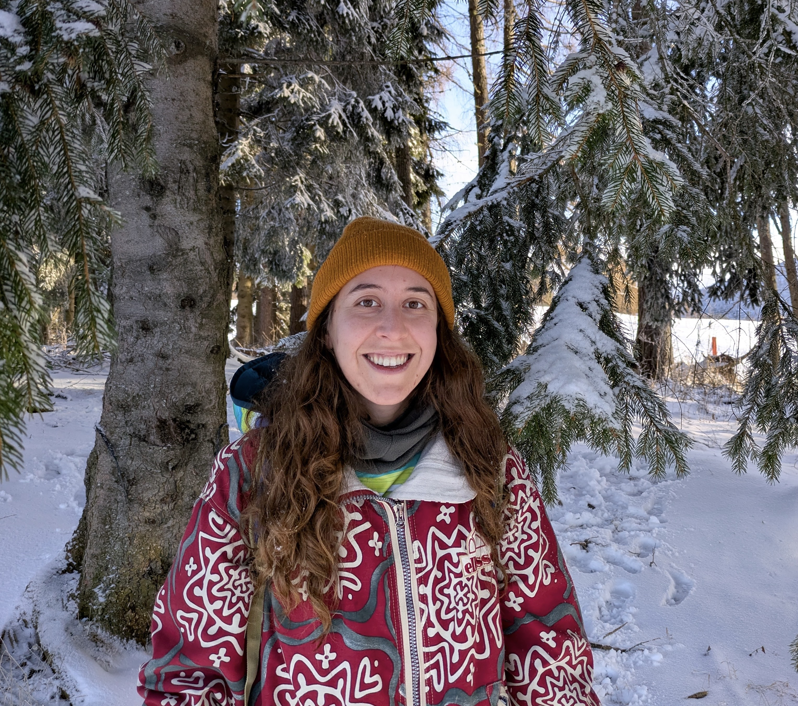

  
  <!-- La foto -->
  
  
  <!-- Il testo -->
  

    <h1 style="margin-top: 0;">Welcome!</h1>
    
    

  I am a mathematician and a researcher in <strong>hyperbolic geometry</strong>. 
  I recently received my PhD from the University of Trento in October 2026.

  In my PhD thesis, I used the quaternionic formalism to approach the difficult problem of finding deformations of hyperbolic manifolds in higher dimensions. Namely, I focused on dimensions 3 to 5.

  <strong>Currently on the job market!! </strong>

  Contact me at: <strong>gemma.dipetrillo [at] gmail.com</strong>

  

